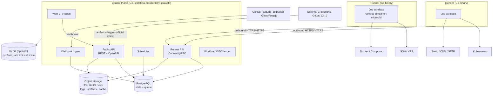

# Architecture

Status: **Draft v0.1** (design phase). Decisions referenced as ADR-NNNN live in [`Plan/ADR/`](../Plan/ADR/).

## 1. Overview

Dhow separates the **control plane** ("the brain") from **runners** ("the hands").
The control plane never executes user code. Runners execute jobs inside ephemeral sandboxes and talk to the
control plane over **outbound-only** connections, so they work behind NAT and firewalls and inside closed networks.



## 2. Components

### 2.1 Control plane (`apps/server`, Go — ADR-0003)

A modular monolith shipped as a single binary. The modules are listed below; each one has its own package and owns its own tables. On disk, `apps/server/internal` holds `App` (router and bootstrap), `Config`, `Core` (errors, response envelope, i18n, middleware, event bus), `Database` (migrations and generated queries) and `Modules/<Name>` (routes, controller, service, models, queries, generated API code and tests). Only `App` imports modules, and modules talk to each other through the event bus.

| Module | Responsibility |
|---|---|
| `identity` | Users, sessions, TOTP, Passkeys (WebAuthn), OIDC login. SAML/SCIM come from `ee/`. |
| `authz` | The central `can(subject, action, resource)` policy. Every handler calls it. See the [security model](security-model.md). |
| `orgs` | Organizations, teams, memberships. Multi-org from day one (ADR-0016). |
| `projects` | Projects, repositories, environments, protection rules, targets. |
| `pipelines` | Fetching, parsing and validating `.dhow.yml` (shared Go package with the runner), and evaluating CEL expressions. |
| `scheduler` | Turns triggers into deployments, jobs and steps, and enqueues jobs. Enforces concurrency groups and per-environment locks. |
| `runners` | Runner registration, leasing, heartbeats, capability matching (labels, OS/arch, isolation level). |
| `secrets` | Envelope encryption and runtime secret delivery. |
| `artifacts` | Content-addressed artifacts, plus build cache entries. |
| `logs` | Ingest of sequenced log chunks, storage, and SSE fan-out. |
| `audit` | Append-only, hash-chained audit log. |
| `notify` | A notification queue and channel adapters. |
| `integrations` | Git providers (GitHub App, GitLab, Bitbucket, Gitea/Forgejo, generic Git), commit statuses and checks. |
| `license` | Offline Ed25519 license verification and the entitlement checks. |

**API surfaces (ADR-0005):**
- **Public REST + OpenAPI 3.1** for the UI, CLI, Terraform provider and third parties. The spec is the source of truth, and the TypeScript client for the UI is generated from it.
- **Connect/gRPC** between runners and the control plane. It carries job leasing, log streaming, artifact upload and status updates, with protobuf contracts in `packages/proto`.
- **SSE** for live UI updates (logs and status). It works through proxies and is authenticated with the session cookie.

### 2.2 Runner (`apps/runner`, Go — ADR-0003, ADR-0007)

- Ships as a single static binary for linux/amd64, linux/arm64, windows/amd64 and darwin/arm64.
- **Registration.** The runner presents a one-time registration token and receives a runner identity: an Ed25519 keypair whose public key is pinned server-side, plus a short-lived access token that it refreshes with a signed challenge. Admins can revoke a runner instantly.
- **Pull-based and outbound only.** The runner long-polls or streams `LeaseJob` and never opens an inbound port.
- **Executes each job in a fresh sandbox:**
  - **Default:** a rootless Docker/Podman container with CPU, memory, PIDs, disk and wall-clock limits. Network egress is denied by default and opened through an allowlist in the job definition. The root filesystem is read-only except `/workspace` and `/tmp`, and no host mounts are allowed.
  - **Hardened (optional):** gVisor (`runsc`) or a Firecracker microVM. Firecracker as the default isolation level is an Enterprise feature; gVisor is available in Community.
  - **Teardown:** the sandbox, its workspace and any injected secrets are destroyed after every job.
- **Secret masking happens in the runner.** The runner masks secrets on the line-buffered output stream *before* anything leaves the host. It also masks the common encodings of each secret (base64 and URL-encoded).
- **Shared code with the server:** the YAML schema, the CEL evaluator, and the protocol.

### 2.3 Storage (ADR-0006)

| Store | Use | Notes |
|---|---|---|
| **PostgreSQL 18** (required, for native `uuidv7()`) | All state, plus the job queue (`FOR UPDATE SKIP LOCKED`), advisory locks (migrations, environment locks), and `LISTEN/NOTIFY` for intra-cluster events | The only required stateful dependency. Migrations run as a separate locked step. |
| **Object storage** (required, with a disk default) | Logs, artifacts and build cache | S3-compatible (AWS S3, R2, MinIO) or local disk for single-node installs. |
| **Redis** (optional) | Cross-instance pub/sub fan-out, distributed rate limits, and hot caches at high scale | When Redis is absent, the same interfaces fall back to Postgres. |

## 3. Data model (core)

```
Organization ─┬─ Team ── Membership(User, Role)
              ├─ Runner pool / Runner (labels, isolation level)
              ├─ Org secrets
              └─ Project ─┬─ Repository link (provider, repo id, install id)
                          ├─ Project secrets
                          └─ Environment ─┬─ Protection rules (reviewers, branches, windows, wait timer)
                                          ├─ Environment secrets
                                          ├─ Targets
                                          └─ Deployment ── Job ── Step
                                                 │          └─ Log chunks (seq), Artifacts
                                                 └─ Release (artifact digest, target, status, health)
AuditEvent (org-scoped, hash-chained) · NotificationRule · LicenseState
```

The following hold across the model:
- Every row is scoped to an `organization_id`, and every query must go through tenant-scoped repository functions.
- IDs are UUIDv7 (time-ordered), so they cannot be enumerated.
- Soft-delete is used for projects and environments, and audit events are never cascade-deleted.

## 4. Deployment and job lifecycle

```
trigger (push / tag / PR / manual / API / external-CI artifact / schedule)
  → resolve pipeline (.dhow.yml at the commit) → validate schema → evaluate `if:` (CEL)
  → create Deployment (queued) → expand jobs (needs DAG, matrix)
  → environment gate: protection rules → approvals (if required) → wait timer / window
  → enqueue Job (priority, concurrency group, environment lock)
  → runner leases Job (lease with TTL + heartbeat) → sandbox → steps
  → logs streamed (seq-numbered chunks) → artifacts uploaded (digest)
  → deploy step: release to target (atomic) → health check
  → success: mark release current │ failure: auto-rollback to previous release
  → statuses → Git provider checks, notifications, audit events
```

**Reliability rules:**
- **Exactly-once deployment semantics.** A deployment job is never retried automatically after it has started mutating a target. Retries apply only to infrastructure failures that happen *before* the first mutating step. A user can still trigger a re-run explicitly.
- **Leases.** A job whose runner stops heartbeating is marked `lost` and reconciled; the system never assumes the job succeeded. Reconciliation runs at startup and periodically.
- **Environment lock.** At most one active deployment per environment and target, unless a pipeline explicitly opts into parallel deployment.
- **Cancellation** is a state transition that the runner observes. The runner kills the whole sandbox, never individual PIDs on a host.

## 5. Logs

- The runner sends **sequenced chunks** of the form `(job_id, seq, ts, stream, bytes)`. The control plane writes them to object storage in segments and indexes the offsets.
- The UI reads history with `GET /logs?from=seq`, then follows over SSE. Clients resume from the last `seq` they saw, so there are no gaps and no duplicates.
- Steps are collapsible groups, and the UI parses ANSI into styled spans. Raw output is never injected as HTML.
- Logs have a size cap per job (configurable) and a retention policy per organization.

## 6. Secrets

- **Envelope encryption.** Each environment (and also each org and each project) has its own DEK, generated randomly as AES-256-GCM with a 12-byte nonce. Each secret is encrypted with AAD = `org/project/env/name/version`.
- **KEK.** DEKs are encrypted with a KEK that comes from a file or environment variable in Community, or from HashiCorp Vault Transit, AWS/GCP/Azure KMS or an HSM in Enterprise. KEKs are versioned, and rotation re-wraps the DEKs without re-encrypting the data.
- **API exposure.** The API never returns secret values. Secrets are write-only, and reads return metadata only: name, version, updated-by and updated-at.
- **Delivery.** Secrets are decrypted **only** at lease time, only for the job's environment scope, and sent over the runner channel. They are mounted as environment variables or tmpfs files and destroyed when the sandbox is torn down.
- **Untrusted triggers.** Secrets are never available to jobs triggered by untrusted sources, such as PRs from forks, unless an admin explicitly approves the run.

## 7. Workload identity (OIDC issuer)

Dhow publishes a JWKS and signs short-lived job tokens. The claims include `org`, `project`, `environment`, `ref` and `deployment_id`, and the audience can be configured. With these tokens, cloud providers can trust Dhow jobs directly, and users do not need to store long-lived AWS/GCP/Azure keys.

## 8. Artifacts and releases

- An **artifact** is a content-addressed (sha256) tarball or an OCI image. Builds happen either in Dhow or in external CI, and in both cases the deployment references the digest (ADR-0010).
- **Atomic releases on hosts (SSH/VPS):**
  1. Upload the artifact to `releases/<release-id>/`.
  2. Link shared directories such as `shared/storage` and `.env`.
  3. Run pre-switch hooks.
  4. **Atomically switch the `current` symlink.**
  5. Reload the service (systemd/PM2/custom).
  6. Run the health check.
  7. If the health check fails, switch the symlink back automatically.

  The last N releases are kept (configurable).
- **Rollback** means re-deploying a previous release, or the artifact digest behind it. It **never rebuilds from source**.
- **Container targets** use image digests (never mutable tags) and a rollout status. Kubernetes targets use Helm/Kustomize/manifests with rollout watching.

## 9. Targets (ADR-0011)

| Target | Mechanism | v1.0 |
|---|---|---|
| SSH / VPS | Runner-side SSH with pinned host keys, atomic releases, systemd/PM2 reload | ✅ |
| Docker / Compose host | Remote Docker API over SSH or TLS, image digest, compose up with health wait | ✅ |
| Kubernetes | kubeconfig or workload identity, Helm/Kustomize/manifests, rollout status | ✅ |
| Static / CDN / SFTP | S3 / R2 / Cloudflare Pages, SFTP/FTPS sync for shared hosting, CDN purge | ✅ |

Target credentials are environment-scoped secrets. Host keys and TLS fingerprints are pinned when the target is created.

## 10. Git providers (ADR-0012)

| Provider | Integration |
|---|---|
| GitHub | GitHub App with fine-grained permissions, installation tokens, check runs and Deployments API |
| GitLab | GitLab.com and self-managed, through OAuth app or project/group tokens, commit statuses and environments |
| Bitbucket | Cloud and Data Center |
| Gitea / Forgejo / generic Git | Webhooks with HMAC, or polling, plus deploy keys |

Rules for every provider:
- Webhooks must carry a per-repository secret, verified in constant time over the raw body.
- A delivery-id is used for replay protection.

## 11. Pipelines and plugins

- Pipelines are defined in **`.dhow.yml` in the repository** and versioned with the code. The visual editor generates YAML and opens a PR (ADR-0008). See the [pipeline spec](pipeline-spec.md).
- Reusable steps are **container images** (`uses: registry/plugin@sha256:…`) that receive typed inputs. A plugin can be written in any language and runs inside the same sandbox. Dhow will host a community registry with verified publishers (ADR-0009).

## 12. Notifications (ADR-0025)

- **Channels:** Email (SMTP), a generic **signed webhook**, Slack, Microsoft Teams, Telegram, Discord and WhatsApp Business (Cloud API).
- **Interactive approvals:** Slack and Teams support approve/reject buttons with signed callbacks.
- Notifications are delivered from **their own queue** with timeouts and retries, so they never block deployments.
- **SSRF guard:** destination URLs are resolved and private, loopback and link-local ranges are rejected after DNS resolution. Admins can configure an allowlist.

## 13. Installation (ADR-0024)

| Method | Audience |
|---|---|
| **Docker Compose one-liner** (`curl … \| sh` that writes the compose file plus generated secrets) | Default for most users |
| **Helm chart** | Kubernetes users and HA deployments |
| **Single binary + systemd** | Small VPS and setups without Docker on the control plane |
| **Air-gapped bundle** (signed images, checksums, offline license) | Enterprise |

The first boot does three things:
- generates strong secrets if none were provided;
- **refuses to start** with known placeholder values;
- prints a one-time URL for creating the owner account (registration is closed).

## 14. Observability

- `/metrics` exposes Prometheus metrics: queue depth, lease latency, job and deployment duration and outcome, runner health and API latency.
- OpenTelemetry traces cover the path from trigger to deployment to job.
- Logs are structured JSON with request and trace IDs. Logs are redacted by default.
- Health endpoints: `/health/live` (process) and `/health/ready` (database, object store, migrations up to date).

## 15. High availability and scale

- **Control plane.** Instances are stateless, and N replicas can run behind a load balancer. Cross-instance events (SSE fan-out) travel over Postgres `LISTEN/NOTIFY`, or over Redis when it is configured. Schedulers coordinate through advisory locks and leases.
- **Runners** scale horizontally. Runner pools carry labels and can be autoscaled; an autoscaler is planned.
- **Database.** Dhow relies on standard Postgres HA (managed service, Patroni, or a CloudNativePG operator).
- **Backups.** The backup guide covers the database, the object store and **the KEK**. Losing the KEK means losing every secret. Dhow will also ship a restore drill command.

## 16. Repository layout (ADR-0004)

```
apps/
  server/     Go control plane
  runner/     Go runner
  web/        React UI (Vite)
  cli/        Go CLI (`dhow`)
packages/
  proto/      Connect/gRPC contracts
  spec/       .dhow.yml JSON Schema + CEL function library (Go, used by server & runner)
  openapi/    OpenAPI spec → generated TS client
  ui/         Design-system components (React)
ee/           Commercial features (separate license)
deploy/       compose/, helm/, systemd/, airgap/
docs/
```
