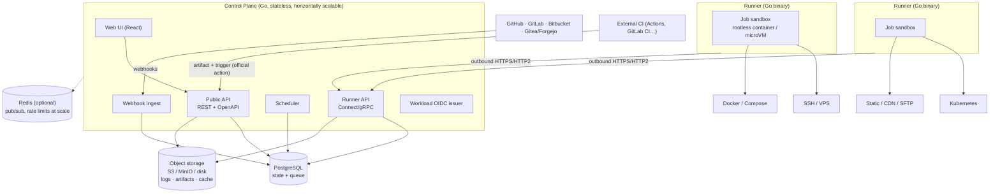

[English](en/architecture.md)

# المعمارية

الحالة: **مسودة v0.1** (مرحلة التصميم). القرارات المشار إليها كـ ADR-NNNN موجودة في [`Plan/ADR/`](../Plan/ADR/).

## 1. نظرة عامة

يفصل داو (Dhow) بين **لوحة التحكم (control plane)** ("العقل") و**أجهزة التشغيل (runners)** ("الأيدي").
لوحة التحكم لا تنفّذ كود المستخدمين أبدًا. أجهزة التشغيل تنفّذ التشغيلات (jobs) داخل بيئات معزولة مؤقتة، وتتصل بلوحة التحكم عبر اتصالات **إلى الخارج فقط**. لذلك تعمل خلف NAT وجدران الحماية وداخل الشبكات المغلقة.



## 2. المكوّنات

### 2.1 لوحة التحكم (`apps/server`، Go — ADR-0003)

برنامج واحد مقسّم إلى وحدات (modular monolith)، ويُنشر كملف تنفيذي واحد. الوحدات مذكورة أدناه. لكل منها حزمة خاصة، وتملك جداولها. على القرص، `apps/server/internal` فيه `App` (الـ router والتشغيل الأولي)، و`Config`، و`Core` (الأخطاء، وغلاف الرد، والترجمة، والـ middleware، وناقل الأحداث)، و`Database` (التحديثات والاستعلامات المولَّدة)، و`Modules/<Name>` (المسارات، والـ controller، والـ service، والنماذج، والاستعلامات، وكود الـ API المولَّد، والاختبارات). وحده `App` يستورد الوحدات، والوحدات تتواصل عبر ناقل الأحداث.

| الوحدة | المسؤولية |
|---|---|
| `identity` | المستخدمون، والجلسات، وTOTP، ومفاتيح المرور (WebAuthn)، والدخول بـ OIDC. SAML/SCIM تأتي من `ee/`. |
| `authz` | سياسة `can(subject, action, resource)` المركزية. كل معالِج يستدعيها. راجع [نموذج الأمان](security-model.md). |
| `orgs` | المؤسسات، والفرق، والعضويات. تعدد المؤسسات من اليوم الأول (ADR-0016). |
| `projects` | المشاريع، والمستودعات، والبيئات، وقواعد الحماية، والأهداف. |
| `pipelines` | جلب `.dhow.yml` وتحليله والتحقق منه (حزمة Go مشتركة مع جهاز التشغيل)، وتقييم تعبيرات CEL. |
| `scheduler` | يحوّل المحفّزات إلى عمليات نشر وتشغيلات وخطوات، ويضع التشغيلات في الطابور. ويفرض مجموعات التزامن والأقفال لكل بيئة. |
| `runners` | تسجيل أجهزة التشغيل، والحجز، والنبضات، ومطابقة القدرات (الأوسمة، والنظام والمعمارية، ومستوى العزل). |
| `secrets` | التشفير المغلّف، وتسليم الأسرار وقت التشغيل. |
| `artifacts` | الملفات الناتجة المعنونة بالمحتوى، ومدخلات cache البناء. |
| `logs` | استقبال أجزاء السجلات المرقّمة، وتخزينها، وبثها عبر SSE. |
| `audit` | سجل أحداث للإضافة فقط، مربوط بسلسلة hashes. |
| `overview` | أعداد للقراءة فقط للصفحة الرئيسية والقائمة الجانبية في طلب واحد: التشغيلات النشطة والفاشلة، وأجهزة التشغيل حسب الحالة، والدعوات المعلّقة (ADR-0061). تقرأ جداول التشغيلات وأجهزة التشغيل والدعوات، ولا تملك أيًّا منها. |
| `notify` | طابور إشعارات ومحوّلات للقنوات. |
| `integrations` | مزوّدو Git (GitHub App، وGitLab، وBitbucket، وGitea/Forgejo، وGit العام)، وحالات الـ commits والفحوص. |
| `license` | التحقق من الترخيص بـ Ed25519 بلا إنترنت، وفحوص الاستحقاقات. |

**واجهات الـ API (ADR-0005):**
- **REST عام + OpenAPI 3.1** للواجهة، والـ CLI، ومزوّد Terraform، والأطراف الأخرى. المواصفات هي مصدر الحقيقة، وعميل TypeScript للواجهة مولَّد منها.
- **Connect** بين أجهزة التشغيل ولوحة التحكم، على `/runner-api/` (أو على عنوان استماع TLS مخصص). يحمل التسجيل، وحجز التشغيلات، وأجزاء السجلات، ورفع الملفات الناتجة، وتحديثات الحالة، مع عقود protobuf في `packages/proto`. نستخدم RPCs أحادية فقط، فيعمل مسار أجهزة التشغيل عبر HTTP/1.1 أو HTTP/2 خلف أي وكيل عكسي (ADR-0042).
- **SSE** للتحديثات المباشرة في الواجهة (السجلات والحالة). يعمل عبر الوكلاء، ومصادقته بكوكي الجلسة.

### 2.2 جهاز التشغيل (`apps/runner`، Go — ADR-0003، ADR-0007، ADR-0041 إلى ADR-0048)

- يُنشر كملف تنفيذي ثابت واحد لـ linux/amd64 وlinux/arm64. التشغيلات تعمل على Linux فقط. أجهزة تشغيل Windows وmacOS مؤجلة حتى يكون لها مشغّل بيئة معزولة.
- **التسجيل والهوية (ADR-0041).**
  - ينشئ المدير رمز تسجيل. يعمل مرة واحدة افتراضيًا، ومحصور في مؤسسة واحدة وأوسمتها، وتنتهي صلاحيته خلال 24 ساعة.
  - يولّد جهاز التشغيل محليًا مفتاح توقيع Ed25519 ومفتاح تشفير HPKE (MLKEM768-X25519). يثبّت السيرفر المفتاحين العامّين، والمفاتيح الخاصة لا تغادر الجهاز أبدًا.
  - يبادل جهاز التشغيل تحديًا موقّعًا برمز وصول يعيش 15 دقيقة. بدء التشغيل يحتاج إلى توقيع جديد، فالرمز المسروق وحده لا يجلب الأسرار.
  - يتحقق جهاز التشغيل من السيرفر عبر TLS، وعبر مفتاح Ed25519 مثبّت يوقّع كل منحة حجز.
  - يستطيع المديرون إلغاء جهاز تشغيل فورًا. لا يوجد mTLS ولا سلطة شهادات داخلية، لأن TLS ينتهي عند الوكيل العكسي.
- **بالسحب وإلى الخارج فقط (ADR-0042).**
  - يطلب جهاز التشغيل `Lease` بطلب طويل (حتى 25 ثانية)، ولا يفتح أبدًا منفذًا للاتصالات الواردة.
  - يدوم الحجز 45 ثانية، وتجدّده نبضة كل 10 ثوانٍ. كل محاولة تحمل رقم حجز، وكل طلب يغيّر الحالة يُفحص مقابله.
  - يقتل جهاز التشغيل بيئته المعزولة قبل أن يعتبر السيرفر الحجز مفقودًا، فلا تتداخل محاولتان أبدًا.
- **ينفّذ كل تشغيل في بيئة معزولة جديدة (ADR-0043، ADR-0044):**
  - **الافتراضي:** حاوية Podman بلا root (crun) بإعدادات Podman الخاصة بنا. بعد إنشائها يفحص جهاز التشغيل الحاوية، ويُغلق عند أي اختلاف.
    - بلا أي capabilities، مع `no-new-privileges`، وملف seccomp الخاص بنا، ونطاق user namespace منفصل لكل تشغيل.
    - حدود cgroup v2 تغطي المعالج، والذاكرة، وPIDs، والقرص (`/workspace` هو tmpfs بحجم محدد)، مع حد للوقت الفعلي.
    - نظام الملفات الجذري للقراءة فقط إلا `/workspace` و`/tmp`، ولا نسمح بربط ملفات الجهاز.
    - PID 1 هو الوكيل (agent) الخاص بجهاز التشغيل. ينفّذ الخطوات، ويخرج (فيقتل الحاوية) إذا اختفى جهاز التشغيل.
  - **الشبكة:** دائمًا `--network=none`. نفتح الخروج فقط عبر وكيل لكل تشغيل في جهاز التشغيل، يصل إليه الوكيل الداخلي على `127.0.0.1:3128`، مع قائمة أسماء أجهزة مسموحة من تعريف التشغيل. لا DNS داخل البيئة المعزولة، والنطاقات الخاصة وloopback وlink-local وmetadata ممنوعة دائمًا.
  - **المحصّن (اختياري):** gVisor (`runsc`) أو Firecracker microVM. جعل Firecracker مستوى العزل الافتراضي ميزة في Enterprise، وgVisor متاح في Community.
  - **Kubernetes:** ينشئ جهاز التشغيل Pod مقيّدًا لكل تشغيل (مع `RuntimeClass` لـ gVisor على مجموعة أجهزة مخصصة اختياريًا)، بدل أن يشغّل الحاويات بنفسه (ADR-0048).
  - **التنظيف:** تُدمَّر البيئة المعزولة، ومساحة عملها، وأي أسرار أُدخلت إليها، بعد كل تشغيل. عند إعادة التشغيل، يحذف جهاز التشغيل أي حاوية تركها.
- **الأسرار (ADR-0045).**
  - تصل الأسرار مرة واحدة لكل محاولة، مختومة بـ HPKE لمفتاح جهاز التشغيل المثبّت، ومربوطة بالحجز ورقم الحجز.
  - تعيش في الذاكرة فقط، وفي بيئة الخطوة أو tmpfs خاص بالحاوية، وليست أبدًا في إعدادات الحاوية أو على القرص.
- **إخفاء الأسرار يحدث في جهاز التشغيل.** يخفي جهاز التشغيل الأسرار في بث المخرجات المخزّن سطرًا بسطر، *قبل* أن يُكتب أي شيء على القرص أو يغادر الجهاز. ويخفي أيضًا الترميزات الشائعة لكل سر (base64، وترميز الروابط، والهروب في JSON، وكل سطر من سر متعدد الأسطر).
- **كود مشترك مع السيرفر:** مدقق مواصفات التشغيل، ومخطط YAML، ومقيّم CEL، والبروتوكول.

### 2.3 التخزين (ADR-0006)

| المخزن | الاستخدام | ملاحظات |
|---|---|---|
| **PostgreSQL 18** (مطلوب، لأجل `uuidv7()` المدمجة) | كل الحالة، مع طابور التشغيلات (`FOR UPDATE SKIP LOCKED`)، وadvisory locks (التحديثات، وأقفال البيئات)، و`LISTEN/NOTIFY` لأحداث داخل العنقود | الاعتمادية الوحيدة المطلوبة التي تحفظ حالة. التحديثات تعمل كخطوة منفصلة بقفل. |
| **تخزين الكائنات** (مطلوب من M4، والقرص هو الافتراضي) | الملفات الناتجة، وcache البناء، وأجزاء السجلات المضغوطة (السجلات المباشرة تبقى في Postgres) | متوافق مع S3 (AWS S3، وR2، وMinIO)، أو القرص المحلي للتثبيتات على جهاز واحد. |
| **Redis** (اختياري) | بث pub/sub بين النسخ، وحدود الطلبات الموزّعة، وcaches سريعة في الحجم الكبير | عند غياب Redis، ترجع الواجهات نفسها إلى Postgres. |

## 3. نموذج البيانات (الأساسي)

```
Organization ─┬─ Team ── Membership(User, Role)
              ├─ Runner pool / Runner (labels, isolation level)
              ├─ Org secrets
              └─ Project ─┬─ Repository link (provider, repo id, install id)
                          ├─ Project secrets
                          └─ Environment ─┬─ Protection rules (reviewers, branches, windows, wait timer)
                                          ├─ Environment secrets
                                          ├─ Targets
                                          └─ Deployment ── Job ── Step
                                                 │          └─ Log chunks (seq), Artifacts
                                                 └─ Release (artifact digest, target, status, health)
AuditEvent (org-scoped, hash-chained) · NotificationRule · LicenseState
```

هذه القواعد تنطبق على النموذج كله:
- كل صف محصور في `organization_id`، وكل استعلام يجب أن يمر عبر دوال مستودع محصورة في المؤسسة.
- المعرّفات UUIDv7 (مرتّبة زمنيًا)، فلا يمكن تعدادها.
- الحذف الناعم للمشاريع والبيئات، وأحداث سجل الأحداث لا تُحذف بالتتابع أبدًا.

## 4. دورة حياة النشر والتشغيل

```
trigger (push / tag / PR / manual / API / external-CI artifact / schedule)
  → resolve pipeline (.dhow.yml at the commit) → validate schema → evaluate `if:` (CEL)
  → create Deployment (queued) → expand jobs (needs DAG, matrix)
  → environment gate: protection rules → approvals (if required) → wait timer / window
  → enqueue Job (priority, concurrency group, environment lock)
  → runner leases Job (lease with TTL + heartbeat) → sandbox → steps
  → logs streamed (seq-numbered chunks) → artifacts uploaded (digest)
  → deploy step: release to target (atomic) → health check
  → success: mark release current │ failure: auto-rollback to previous release
  → statuses → Git provider checks, notifications, audit events
```

**قواعد الموثوقية:**
- **النشر مرة واحدة بالضبط.** تشغيل النشر لا يُعاد تلقائيًا أبدًا بعد أن يبدأ في تغيير هدف. إعادة المحاولة تنطبق فقط على أعطال البنية التي تحدث *قبل* أول خطوة تغيّر الهدف. ما زال المستخدم يستطيع بدء إعادة تشغيل صراحة.
- **الحجوزات.** التشغيل الذي يتوقف جهاز تشغيله عن النبض يُعلَّم `lost` ويُطابَق. النظام لا يفترض أبدًا أن التشغيل نجح. المطابقة تعمل عند البدء وبشكل دوري.
- **قفل البيئة.** نشر نشط واحد بالأكثر لكل بيئة وهدف، إلا إذا اختارت خطوات النشر النشر المتوازي صراحة.
- **الإلغاء** انتقال في الحالة يراه جهاز التشغيل. يقتل جهاز التشغيل البيئة المعزولة كلها، وليس عمليات منفردة على الجهاز أبدًا.

## 5. السجلات

- يرسل جهاز التشغيل **أجزاء مرقّمة** بالشكل `(attempt_id, seq, ts, stream, bytes)`. يبدأ `seq` من 1 بلا فجوات، فالإضافة آمنة للتكرار، والفجوات تُكتشف (ADR-0046).
- من M3، تُحفظ الأجزاء في جدول Postgres مقسّم حسب اليوم. الاحتفاظ يحذف أجزاء كاملة. مع مخزن الملفات في M4، تُضغط المحاولات المنتهية إلى أجزاء في تخزين الكائنات مع فهرس للمواضع.
- يخفي جهاز التشغيل الأسرار قبل أن يغادره الجزء، في الذاكرة وفي ملف الفائض (ADR-0045). يحفظ السيرفر الأجزاء كما تصله ولا يخفي مرة أخرى أبدًا، ولا يكتب محتوى السجل في سجله هو أبدًا.
- تقرأ الواجهة التاريخ بـ `GET .../jobs/{jobId}/logs?FromSeq=`، ثم تتابع عبر SSE. يستأنف العملاء بـ `Last-Event-ID` من آخر `seq` رأوه، فلا فجوات ولا تكرار. تبث نسخ السيرفر الأجزاء الجديدة عبر `LISTEN/NOTIFY`، وكل بث يقرأ صفوفه بعد آخر `seq` أرسله، فالعميل البطيء لا يؤخر الآخرين أبدًا.
- الخطوات مجموعات قابلة للطي، والواجهة تحلل ANSI إلى أجزاء منسّقة. لا ندخل المخرجات الخام كـ HTML أبدًا.
- للسجلات حد حجم لكل محاولة (`DHOW_JOB_LOG_MAX_BYTES`)، ومدة احتفاظ لكل نسخة سيرفر (`DHOW_LOG_RETENTION_DAYS`). الاحتفاظ لكل مؤسسة يأتي مع الأجزاء في M4.

## 6. الأسرار

- **التشفير المغلّف.** لكل بيئة (ولكل مؤسسة ومشروع أيضًا) مفتاح DEK خاص، مولَّد عشوائيًا كـ AES-256-GCM مع nonce بـ 12 بايت. كل سر مشفّر مع AAD = `org/project/env/name/version`.
- **KEK.** مفاتيح DEK مشفّرة بمفتاح KEK يأتي من ملف أو متغير بيئة في Community، أو من HashiCorp Vault Transit، أو AWS/GCP/Azure KMS، أو HSM في Enterprise. لمفاتيح KEK إصدارات، والتدوير يعيد تغليف مفاتيح DEK بدون إعادة تشفير البيانات.
- **الظهور في الـ API.** لا يُرجع الـ API قيم الأسرار أبدًا. الأسرار للكتابة فقط، والقراءة تُرجع البيانات الوصفية فقط: الاسم، والإصدار، ومن حدّثه، ومتى.
- **التسليم.** تُفك الأسرار **فقط** وقت الحجز، فقط لنطاق بيئة التشغيل، وتُرسل عبر قناة جهاز التشغيل. تُربط كمتغيرات بيئة أو ملفات tmpfs، وتُدمَّر عند هدم البيئة المعزولة.
- **المحفّزات غير الموثوقة.** الأسرار لا تتاح أبدًا للتشغيلات التي تبدأها مصادر غير موثوقة، مثل PRs من الـ forks، إلا إذا وافق مدير على التشغيل صراحة.

## 7. هوية الأحمال (مُصدِر OIDC)

ينشر داو JWKS ويوقّع رموزًا قصيرة العمر للتشغيلات. الـ claims تشمل `org` و`project` و`environment` و`ref` و`deployment_id`، والجمهور (audience) قابل للضبط. بهذه الرموز يستطيع مزوّدو السحابة الثقة بتشغيلات داو مباشرة، ولا يحتاج المستخدمون إلى حفظ مفاتيح AWS/GCP/Azure طويلة العمر.

## 8. الملفات الناتجة والإصدارات

- **الملف الناتج (artifact)** أرشيف tar معنون بالمحتوى (sha256) أو صورة OCI. البناء يحدث في داو أو في CI خارجي، وفي الحالتين يشير النشر إلى الـ digest (ADR-0010).
- **الإصدارات الذرية على الأجهزة (SSH/VPS):**
  1. ارفع الملف الناتج إلى `releases/<release-id>/`.
  2. اربط المجلدات المشتركة مثل `shared/storage` و`.env`.
  3. شغّل hooks ما قبل التبديل.
  4. **بدّل الـ symlink المسمى `current` بشكل ذري.**
  5. أعد تحميل الخدمة (systemd/PM2/مخصص).
  6. شغّل فحص الصحة.
  7. إذا فشل فحص الصحة، أعد الـ symlink تلقائيًا.

  نحتفظ بآخر N إصدارات (قابل للضبط).
- **الرجوع (rollback)** يعني إعادة نشر إصدار سابق، أو الـ digest الذي خلفه. و**لا يعيد البناء من الكود أبدًا**.
- **أهداف الحاويات** تستخدم digests الصور (وليس الوسوم القابلة للتغيير أبدًا) وحالة التحديث (rollout). أهداف Kubernetes تستخدم Helm/Kustomize/manifests مع مراقبة التحديث.

## 9. الأهداف (ADR-0011)

| الهدف | الآلية | v1.0 |
|---|---|---|
| SSH / VPS | SSH من جهاز التشغيل مع مفاتيح أجهزة مثبّتة، وإصدارات ذرية، وإعادة تحميل systemd/PM2 | ✅ |
| جهاز Docker / Compose | Docker API عن بُعد عبر SSH أو TLS، وdigest الصورة، وcompose up مع انتظار الصحة | ✅ |
| Kubernetes | kubeconfig أو هوية الأحمال، وHelm/Kustomize/manifests، وحالة التحديث | ✅ |
| Static / CDN / SFTP | S3 / R2 / Cloudflare Pages، ومزامنة SFTP/FTPS للاستضافة المشتركة، ومسح cache الـ CDN | ✅ |

بيانات دخول الأهداف أسرار محصورة في البيئة. مفاتيح الأجهزة وبصمات TLS تُثبَّت عند إنشاء الهدف.

## 10. مزودو Git (ADR-0012)

| المزوّد | التكامل |
|---|---|
| GitHub | GitHub App بصلاحيات دقيقة، ورموز التثبيت، وcheck runs، وDeployments API |
| GitLab | GitLab.com والنسخ المستضافة ذاتيًا، عبر تطبيق OAuth أو رموز المشروع/المجموعة، وحالات الـ commits، والبيئات |
| Bitbucket | Cloud وData Center |
| Gitea / Forgejo / Git العام | Webhooks مع HMAC، أو السؤال الدوري، مع مفاتيح النشر |

قواعد لكل مزوّد:
- كل webhook يجب أن يحمل سرًا خاصًا بالمستودع، نتحقق منه بزمن ثابت على الجسم الخام.
- نستخدم معرّف التسليم (delivery-id) للحماية من إعادة الإرسال.

## 11. خطوات النشر والإضافات

- خطوات النشر معرّفة في **`.dhow.yml` داخل المستودع**، ولها إصدارات مع الكود. المحرر المرئي يولّد YAML ويفتح PR (ADR-0008). راجع [مواصفات خطوات النشر](pipeline-spec.md).
- الخطوات القابلة لإعادة الاستخدام **صور حاويات** (`uses: registry/plugin@sha256:…`) تستلم مدخلات لها أنواع. يمكن كتابة الإضافة بأي لغة، وتعمل داخل البيئة المعزولة نفسها. سيستضيف داو سجلًا للمجتمع مع ناشرين موثّقين (ADR-0009).

## 12. الإشعارات (ADR-0025)

- **القنوات:** البريد (SMTP)، و**webhook موقّع** عام، وSlack، وMicrosoft Teams، وTelegram، وDiscord، وWhatsApp Business (Cloud API).
- **الموافقات التفاعلية:** يدعم Slack وTeams أزرار الموافقة والرفض مع ردود موقّعة.
- تُرسل الإشعارات من **طابور خاص بها** مع مهل وإعادة محاولة، فلا تعطّل النشر أبدًا.
- **حماية SSRF:** نحل عناوين الوجهات، ونرفض النطاقات الخاصة وloopback وlink-local بعد حل DNS. يستطيع المديرون ضبط قائمة مسموحة.

## 13. التثبيت (ADR-0024)

| الطريقة | لمن |
|---|---|
| **أمر واحد لـ Docker Compose** (`curl … \| sh` يكتب ملف compose مع أسرار مولَّدة) | الافتراضي لأغلب المستخدمين |
| **Helm chart** | مستخدمو Kubernetes وعمليات النشر عالية التوفر |
| **ملف تنفيذي واحد + systemd** | VPS صغير، وإعدادات بلا Docker على لوحة التحكم |
| **حزمة بلا إنترنت** (صور موقّعة، وchecksums، وترخيص بلا إنترنت) | Enterprise |

التشغيل الأول يفعل ثلاثة أشياء:
- يولّد أسرارًا قوية إذا لم تُعطَ أي أسرار؛
- **يرفض البدء** مع القيم المؤقتة المعروفة؛
- يطبع رابطًا يعمل مرة واحدة لإنشاء حساب صاحب النسخة (التسجيل مغلق).

## 14. المراقبة

- `/metrics` يعرض مقاييس Prometheus: عمق الطابور، وزمن الحجز، ومدة التشغيلات والنشر ونتيجتها، وصحة أجهزة التشغيل، وزمن الـ API.
- تتبعات OpenTelemetry تغطي المسار من المحفّز إلى النشر إلى التشغيل.
- السجلات JSON منظّم مع معرّفات الطلب والتتبع. السجلات تُنقّح افتراضيًا.
- مسارات الصحة: `/health/live` (العملية) و`/health/ready` (قاعدة البيانات، وتخزين الكائنات، والتحديثات المطبّقة، وجزء سجلات التشغيل لليوم، وآخر إعادة تحميل لإعدادات السيرفر).

## 15. التوفر العالي والتوسع

- **لوحة التحكم.** النسخ بلا حالة، ويمكن تشغيل N نسخة خلف موزّع حمل. الأحداث بين النسخ (بث SSE) تمر عبر `LISTEN/NOTIFY` في Postgres، أو عبر Redis عند ضبطه. المجدولات تتنسق عبر advisory locks والحجوزات.
- **أجهزة التشغيل** تتوسع أفقيًا. مجموعات أجهزة التشغيل لها أوسمة ويمكن توسيعها تلقائيًا، والموسّع التلقائي مخطط له.
- **قاعدة البيانات.** يعتمد داو على التوفر العالي القياسي لـ Postgres (خدمة مُدارة، أو Patroni، أو مشغّل CloudNativePG).
- **النسخ الاحتياطي.** دليل النسخ الاحتياطي يغطي قاعدة البيانات، وتخزين الكائنات، و**مفتاح KEK**. فقدان KEK يعني فقدان كل الأسرار. وسيأتي داو أيضًا بأمر لتمرين الاسترجاع.

## 16. هيكل المستودع (ADR-0004)

```
apps/
  server/     Go control plane
  runner/     Go runner
  web/        React UI (Vite)
  cli/        Go CLI (`dhow`)
packages/
  proto/      Connect/gRPC contracts
  spec/       .dhow.yml JSON Schema + CEL function library (Go, used by server & runner)
  openapi/    OpenAPI spec → generated TS client
  ui/         Design-system components (React)
ee/           Commercial features (separate license)
deploy/       compose/, helm/, systemd/, airgap/
docs/
```
